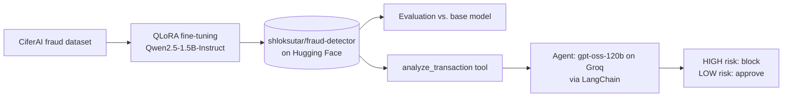

# LLM Fraud Detection: QLoRA Fine-Tuning, Evaluation & AI Agent

Fine-tune a small open LLM to flag fraudulent financial transactions, measure how much the fine-tuning actually helps, and wrap the model in an AI agent that **recommends what to do** (block or approve) instead of just returning a score.

[](https://huggingface.co/shloksutar/fraud-detector)

## What's in this repo

| Notebook | What it does |
|---|---|
| [`fraud_detection_model_final.ipynb`](fraud_detection_model_final.ipynb) | Fine-tunes **Qwen2.5-1.5B-Instruct** with **QLoRA** on the CiferAI fraud dataset and pushes the model to Hugging Face. |
| [`evaluating_fraud_detection_model.ipynb`](evaluating_fraud_detection_model.ipynb) | Compares the base Qwen model against the fine-tuned model on 100 held-out transactions. |
| [`fraud_detection_agent.ipynb`](fraud_detection_agent.ipynb) | Builds a LangChain agent that uses the fine-tuned model as a tool and recommends an action based on the risk level. |

## How it fits together



## 1. Fine-tuning

- **Base model:** `Qwen/Qwen2.5-1.5B-Instruct`
- **Method:** QLoRA (4-bit quantized base model with LoRA adapters)
- **Data:** CiferAI fraud dataset
- **Output:** [`shloksutar/fraud-detector`](https://huggingface.co/shloksutar/fraud-detector) on Hugging Face
- **Hardware:** Google Colab T4 or Kaggle GPU

> **T4 note:** T4 GPUs don't support bf16. If training crashes on a T4, use fp16 instead.

## 2. Evaluation

The evaluation notebook runs both models on **100 held-out transactions** (50 fraud, 50 legitimate, seed 99).

| Model | Accuracy | Precision | Recall | F1 |
|---|---|---|---|---|
| Base Qwen2.5-1.5B-Instruct | 48% | 0% | 0% | 0% |
| **Fine-tuned (this repo)** | **60%** | **58%** | **74%** | **65%** |

**How to read this:**

- Fine-tuning clearly changes the model's behavior. The base model scored 0% on precision, recall and F1, while the fine-tuned model catches about three quarters of the fraud cases.
- The evaluation set is small and results vary between runs (an earlier run gave 50% vs. 55% accuracy), so treat these numbers as indicative, not definitive.
- 60% accuracy leaves a lot of room for improvement. Ideas worth trying: more training data, longer training, and tuning the output format.

## 3. The fraud detection agent

`fraud_detection_agent.ipynb` turns the model into the "brain" of a small agent:

- **Reasoning model:** `openai/gpt-oss-120b` served by [Groq](https://console.groq.com), orchestrated with LangChain's `create_agent`.
- **Tool:** `analyze_transaction` wraps the fine-tuned model and returns a risk level (HIGH / LOW) with reasoning.
- **Policy:** HIGH risk, recommend blocking the transaction. LOW risk, recommend approving it. The agent always explains its reasoning.

Example: a $150 payment with consistent sender and recipient balances comes back as **LOW** risk, and the agent recommends approving it.

### Running the agent

1. Open `fraud_detection_agent.ipynb` in Google Colab and select a **GPU runtime** (a free T4 is enough).
2. Create an API key at [console.groq.com](https://console.groq.com) and add it as a Colab secret named `GROQ_API_KEY` (key icon in the left sidebar, then enable notebook access).
3. Run all cells. The last cells send a normal payment (expected LOW) and a drained-account transfer (expected HIGH) to the agent.

> Never commit an API key. The notebook reads it from Colab secrets (or an environment variable) and stores nothing in the file.

## Using the fine-tuned model directly

The model was trained on prompts in this format:

```python
from transformers import pipeline

generator = pipeline("text-generation", model="shloksutar/fraud-detector", device="cuda")

prompt = """Analyze this transaction for fraud risk:
- Type: TRANSFER
- Amount: $181,000.00
- Sender Balance Before: $181,000.00
- Sender Balance After: $0.00
- Recipient Balance Before: $0.00
- Recipient Balance After: $0.00"""

messages = [{"role": "user", "content": prompt}]
print(generator(messages, max_new_tokens=150, return_full_text=False)[0]["generated_text"])
```

## Tech stack

Python, Hugging Face Transformers, PEFT / QLoRA, LangChain, Groq API, Google Colab, Kaggle

## Limitations

- This is a learning and portfolio project, not a production fraud system. Do not use it to make real financial decisions.
- The model is small (1.5B parameters) and evaluated on a small sample, so it will make mistakes in both directions.
- Results depend on the dataset and the prompt format above.

## Author

**Shlok Sutar** · [GitHub](https://github.com/shloksutar) · [Model on Hugging Face](https://huggingface.co/shloksutar/fraud-detector)
